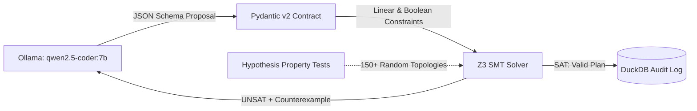

# sandbox-init — Neuro-Symbolic Cluster & AI QA Baseline

Базовая платформа для локальной верификации распределённых систем и LLM-агентов на двух-узловом кластере (`hippo` 24 GiB RAM + `rhino` 16 GiB RAM) без облачных зависимостей.

## Архитектура контура



## Формальные инварианты (Z3)
* **Бюджеты узлов:** `h_llm + h_db + h_res <= 24 GiB` (`h_res >= 4 GiB`) и `r_llm + r_db + r_res <= 16 GiB` (`r_res >= 3 GiB`).
* **Anti-Affinity на `rhino`:** `Implies(r_llm > 6, r_db <= 4)` — защита от OOM при совместном размещении БД и моделей.
* **Dev Headroom:** минимум на одном узле гарантировано >= 4 GiB свободной памяти для сборки и тестов.

## MCP-инструменты (`FastMCP` / `stdio`)
* `check_cluster_allocation` — проверка распределения RAM одного узла с записью вердикта в `DuckDB`.
* `check_cluster_plan` — кросс-узловая верификация конфигурации `hippo` + `rhino`.
* `synthesize_valid_allocation` — автономный цикл CEGIS (Ollama + Z3) для синтеза валидного плана размещения.

## Запуск и QA-гейт
```bash
docker compose build verifier
docker compose run --rm verifier sh -c "ruff check src tests && mypy src tests && pytest -v"
```
