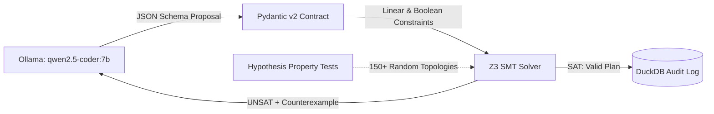

# sandbox-init — Neuro-Symbolic Cluster & AI QA Baseline


> **Change Management:** See [`CHANGELOG.md`](CHANGELOG.md) for formal Change Requests (`CR`), mitigated risks, and QA verification evidence.
Zero-cost, local-first verification baseline for distributed systems and LLM agents running on a heterogeneous two-node Linux cluster (`hippo` 24 GiB RAM + `rhino` 16 GiB RAM) with zero external API dependencies.

## Cluster Repository Map
* **System Design & ADRs:** [`docs/ARCHITECTURE.md`](docs/ARCHITECTURE.md) — Cross-node topology, Docker layer hierarchy, risk matrix, and QA metrics.
- **Engineering Profile Dossier:** [`docs/ENGINEERING_PROFILE.md`](docs/ENGINEERING_PROFILE.md) — standardized 5-section competence, stack, process, and QA metrics specification.
* **Domain 1 — Policy & Compliance Auditor:** [`spanskikh/abstract-ops`](https://github.com/spanskikh/abstract-ops) — Formal Z3 verification of RBAC/underwriting rule-sets via CEGIS.
* **Domain 2 — Grounded Hybrid RAG & Fact-Checker:** [`spanskikh/interview-ops`](https://github.com/spanskikh/interview-ops) — `pgvector` + `tsvector` RRF search with Z3 SSOT anti-hallucination gate.
* **Domain 3 — Triple-Entry Transactional Ledger:** [`spanskikh/hostel-ops`](https://github.com/spanskikh/hostel-ops) — Triple-entry accounting, anti-overbooking, and housekeeping state machine.

## Verification Loop Architecture


## Formal Invariants (Z3)
* **Node Memory Budgets:** `h_llm + h_db + h_res <= 24 GiB` (`h_res >= 4 GiB`) and `r_llm + r_db + r_res <= 16 GiB` (`r_res >= 3 GiB`).
* **Anti-Affinity on `rhino`:** `Implies(r_llm > 6, r_db <= 4)` — prevents OOM when co-locating database and model workloads.
* **Dev Headroom:** Guarantees at least one node retains `>= 4 GiB` free RAM for builds and test suites.

## MCP Tools (`FastMCP` / `stdio`)
* `check_cluster_allocation` — Validates single-node RAM allocation and logs verdict to `DuckDB`.
* `check_cluster_plan` — Cross-node formal verification of `hippo` + `rhino` resource plan.
* `synthesize_valid_allocation` — Autonomous CEGIS loop (Ollama + Z3) synthesizing a valid cluster placement.
* `record_node_memory_telemetry` — Parses `/proc/meminfo`, checks headroom budget, and logs snapshot to `DuckDB`.

## Quickstart & QA Gate
```bash
# Host offline verification gate (logged to logs/)
./scripts/run_logged.sh qa_ruff -- .venv/bin/ruff check src tests
./scripts/run_logged.sh qa_mypy -- .venv/bin/mypy src tests --strict
./scripts/run_logged.sh qa_pytest -- .venv/bin/pytest -v -m "not integration"

# Host/Docker topology-aware live cluster integration runner (CR-024)
./scripts/run_integration.sh --dry-run
./scripts/run_integration.sh

# Cross-repo FastMCP stdio Supervisor/Worker Z3 chain (CR-025)
./scripts/run_supervisor_chain.sh --dry-run
./scripts/run_supervisor_chain.sh --scenario all --format summary

# Shared CycloneDX PEP 610 file:// SBOM sanitizer CLI (CR-026 / CAPA-007)
./scripts/sanitize_sbom.sh --dry-run
./scripts/sanitize_sbom.sh --all-repos

# Containerized verification
docker compose build verifier
docker compose run --rm verifier sh -c "ruff check src tests && mypy src tests && pytest -v"
```

## Cluster Governance & Release Process (Single Source of Truth)

Cluster-wide engineering standards, release roadmaps, and CAPA records are maintained centrally in [`spanskikh/spanskikh`](https://github.com/spanskikh/spanskikh) (`CAPA-004` / `CR-020`):
- [Engineering & AI-Assisted Development Process (`DEVPROCESS.md`)](https://github.com/spanskikh/spanskikh/blob/main/DEVPROCESS.md)
- [Cluster Release Roadmap (`RELEASES.md`)](https://github.com/spanskikh/spanskikh/blob/main/RELEASES.md)
- [Defects & CAPA Registry (`docs/DEFECTS_AND_CAPA.md`)](https://github.com/spanskikh/spanskikh/blob/main/docs/DEFECTS_AND_CAPA.md)
- [Release Retrospectives & Refinements (`docs/releases/`)](https://github.com/spanskikh/spanskikh/tree/main/docs/releases)
