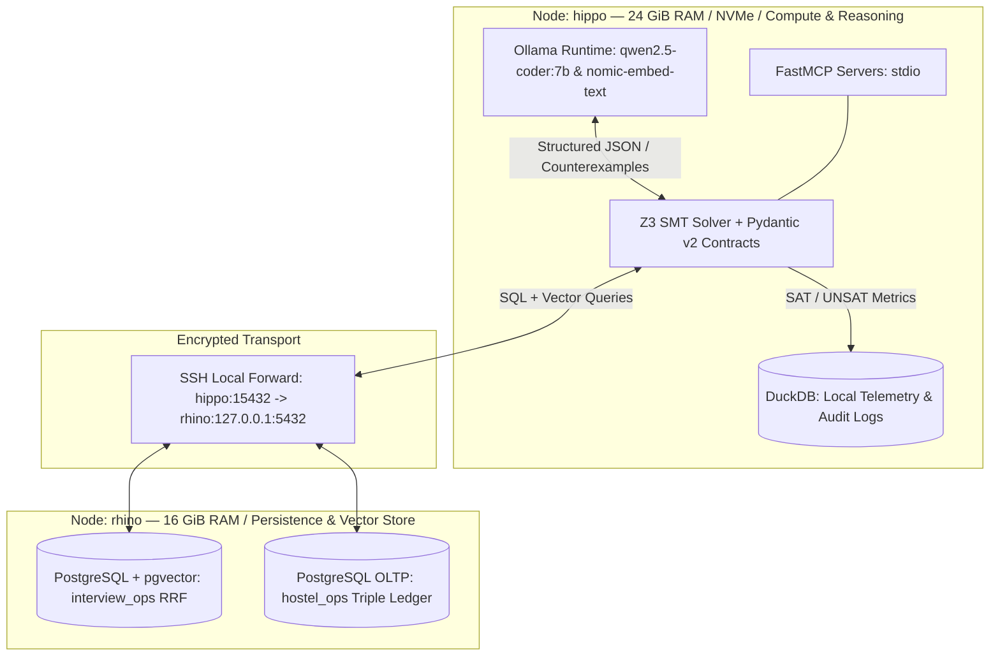

# System Architecture & Engineering Decision Records (Level 2)

Unified architecture of the local neuro-symbolic verification cluster (`hippo` + `rhino`), integrating [`sandbox-init`](https://github.com/spanskikh/sandbox-init), [`abstract-ops`](https://github.com/spanskikh/abstract-ops), [`interview-ops`](https://github.com/spanskikh/interview-ops), and [`hostel-ops`](https://github.com/spanskikh/hostel-ops).

## 1. Cross-Node Topology & Docker Layer Hierarchy
Two Calculate Linux nodes (Intel Core i5-9500, AVX2/FMA, no discrete GPU) separate compute/reasoning from persistence:

**Docker Image Inheritance (`pull_policy: never`):** `sandbox-init-verifier:latest` -> `abstract-ops-auditor:latest` & `interview-ops-rag:latest` -> `hostel-ops-ledger:latest` (~6s incremental builds).

## 2. Architecture Decision Records (ADR)
* **ADR-001 (CEGIS + Z3 SMT over LLM-as-a-Judge):** LLM generates JSON proposals (`temperature=0.0`, fixed `seed`), while Z3 proves invariants (`SAT`) or returns minimal counterexamples (`UNSAT`) for iterative self-correction.
* **ADR-002 (Lightweight Direct Stack):** Async `httpx`, `Pydantic v2` (`model_json_schema()`), `z3-solver`, and `FastMCP` without heavy orchestrators; domain workers stay within `mem_limit: 1g`.
* **ADR-003 (Hybrid RRF Search):** Combines `nomic-embed-text` (768-d) cosine distance and `ts_rank_cd` (`GIN tsvector`) via Reciprocal Rank Fusion (`k=60`).
* **ADR-004 (OLTP vs Audit Telemetry Split):** Transactional state lives in PostgreSQL on `rhino`; CEGIS audit metrics live in embedded `DuckDB` (`memory_limit='512MB'`) on `hippo`.

## 3. Risk & Control Matrix

| Risk Category | Implemented Mitigation | Residual Risk & Planned Hardening |
| :--- | :--- | :--- |
| **LLM Hallucinations & Fact Drift** | Z3 enforcement of `claimed_skills <= ssot.skills`, entity/year lock, and zero-sum ledger balance. | **[CR-003]** Deterministic lexical/year entity extraction from `bullet_text` enforced in Z3 gate. |
| **Z3 Specification Bugs** | Property-based testing via `Hypothesis` (310+ randomized boundary cases against Python oracles). | Expand property generators as new policy predicates are added. |
| **Out-of-Memory (OOM)** | Formal Z3 RAM budget verification (`sandbox-init`), `mem_limit: 1g`, DuckDB `512MB` cap. | **[CR-001]** `/proc/meminfo` headroom telemetry collector persisted to DuckDB (`node_memory_snapshots`). |
| **PII & DB Port Exposure** | 100% local inference; `rhino` PostgreSQL bound to loopback behind SSH tunnel. | Manage SSH tunnel (`15432 -> 5432`) via OpenRC/`autossh` for auto-recovery. |
| **Write Race Conditions (TOCTOU)** | Atomic PostgreSQL transactions on check-in commit and `CLEAN -> DIRTY` transition. | **[CR-004]** PostgreSQL `btree_gist` `EXCLUDE USING gist` constraint on `(bed_id, int4range(check_in_day, check_out_day, '[)'))` + `DIRTY -> CLEAN` housekeeping transition. |

## 4. QA Metrics & Business Outcomes Summary

| Domain | Verified Z3 Invariants | QA & Verification Metrics | Business Outcome |
| :--- | :--- | :--- | :--- |
| **`sandbox-init`** | Node RAM budgets, `rhino` anti-affinity, dev headroom `>= 4 GiB` | `8 passed`, 200 `Hypothesis` cases, `0` `mypy --strict` errors | Deterministic cluster capacity planning without OOM or cloud costs |
| **`abstract-ops`** | Rule reachability, `ALLOW`/`DENY` disjointness, mandatory MFA | `5 passed`, 100% conflict detection, CEGIS convergence in 2 iters | Automated formal compliance auditing of access/underwriting policies |
| **`interview-ops`** | Company, years, skills `<=` SSOT; explicit skill-gap separation | `4 passed`, hybrid RRF retrieval, CEGIS convergence in 2 iters | Hallucination-free CV tailoring with full local GDPR PII isolation |
| **`hostel-ops`** | Zero-sum triple-entry balance, disjoint intervals, `CLEAN`-only check-in | `4 passed`, 80 `Hypothesis` cases, atomic `CLEAN -> DIRTY` update | Elimination of overbooking, dirty-room check-ins, and ledger drift |
