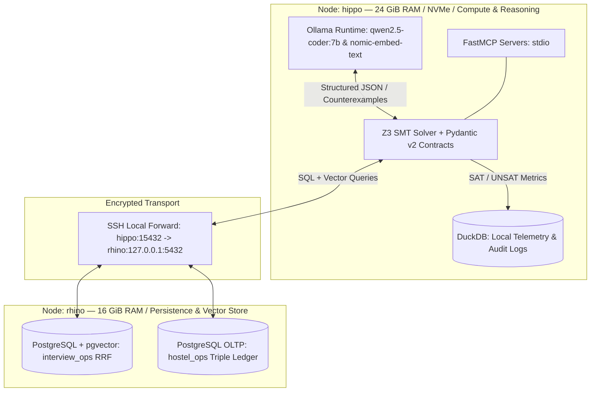

# System Architecture & Engineering Decision Records (Level 2)

Единая архитектура локального нейро-символического кластера (`hippo` + `rhino`), объединяющая четыре репозитория (`sandbox-init`, `abstract-ops`, `interview-ops`, `hostel-ops`) в воспроизводимый конвейер верификации AI-агентов.

---

## 1. Межмашинная топология и слои Docker-образов

Кластер построен на двух узлах Calculate Linux (Intel Core i5-9500, AVX2/FMA, без дискретной GPU) с жёстким разделением вычислительного и транзакционного контуров:

### Дерево наследования локальных Docker-образов (`pull_policy: never`)
Чтобы избежать дублирования зависимостей и ускорить инкрементальную сборку (~6 секунд на домен), образы выстроены в иерархию:
1. `sandbox-init-verifier:latest` — базовый слой (`Python 3.12`, `FastMCP`, `Pydantic v2`, `Z3`, `DuckDB`, `Hypothesis`, `Ruff`, `MyPy`).
2. `abstract-ops-auditor:latest` $\leftarrow$ наследует `sandbox-init-verifier:latest`.
3. `interview-ops-rag:latest` $\leftarrow$ наследует `sandbox-init-verifier:latest` + `psycopg[binary]` + `pgvector`.
4. `hostel-ops-ledger:latest` $\leftarrow$ наследует `interview-ops-rag:latest`.

---

## 2. Architecture Decision Records (ADR)

### ADR-001: CEGIS + Z3 SMT вместо LLM-as-a-Judge
* **Контекст:** Вероятностные метрики оценки LLM не дают формальных гарантий для финансовых проводок, контроля доступа и достоверности резюме.
* **Решение:** Использовать паттерн **Counterexample-Guided Inductive Synthesis (CEGIS)**. LLM генерирует гипотезу в строгой JSON-схеме (`temperature=0.0`, фиксированный `seed`), а Z3 доказывает выполнение инвариантов (`SAT`) или возвращает минимальный контрпример (`UNSAT`), который подаётся в промпт следующей итерации.
* **Последствия:** 100% отсечение недопустимых состояний перед записью в БД; детерминированная воспроизводимость регрессионных прогонов.

### ADR-002: Отказ от монолитных LLM-фреймворков
* **Контекст:** Жёсткий бюджет памяти (24 GiB + 16 GiB RAM) и требование прозрачности промптов/ошибок.
* **Решение:** Прямая интеграция через асинхронный `httpx`, `Pydantic v2` (`model_json_schema()`), `z3-solver` и `FastMCP` без прослоек вроде LangChain.
* **Последствия:** Контейнеры доменных сервисов укладываются в лимит `mem_limit: 1g`, а время холодного старта тестов составляет < 1.5 секунд.

### ADR-003: Гибридный поиск Reciprocal Rank Fusion (RRF) в `pgvector`
* **Контекст:** Чистый векторный поиск теряет точность на названиях компаний, кодах правил и датах.
* **Решение:** Объединение косинусной близости эмбеддингов `nomic-embed-text` (768d) и полнотекстового ранга `ts_rank_cd` (`GIN tsvector`) по формуле $RRF(d) = \frac{1}{60 + r_{vec}(d)} + \frac{1}{60 + r_{fts}(d)}$.
* **Последствия:** Устойчивое извлечение релевантных записей SSOT как по семантике задачи, так и по точным терминам.

### ADR-004: Разделение OLTP (`PostgreSQL`) и телеметрии (`DuckDB`)
* **Контекст:** Необходимость изолировать транзакционное состояние на `rhino` от локального анализа сходимости CEGIS на `hippo`.
* **Решение:** Состояние доменов (`interview_ops`, `hostel_ops`) хранится в PostgreSQL на `rhino`, а журналы аудита и контрпримеров — в встраиваемом `DuckDB` (`memory_limit='512MB'`) на `hippo`.

---

## 3. Матрица рисков и контролей

| Категория риска | Механизм митигации (реализовано) | Остаточный риск и план закрытия |
| :--- | :--- | :--- |
| **Галлюцинации и сдвиг фактов LLM** | Z3-проверка принадлежности навыков $\subseteq$ SSOT, равенства дат/компаний и нулевого баланса проводок. | Свободный текст `bullet_text` в `interview-ops` $\rightarrow$ добавить regex/AST-экстрактор сущностей в Z3-гейт. |
| **Ошибка в формальной спецификации Z3** | Property-based тестирование через `Hypothesis` (310+ случайных конфигураций против Python-оракула). | Расширять генераторы при добавлении новых типов бизнес-правил. |
| **Out-of-Memory (OOM) на узлах** | Z3-модель бюджетов RAM (`sandbox-init`), `mem_limit: 1g` в Docker, лимит 512 МБ в DuckDB. | Добавить фоновый коллектор `/proc/meminfo` и `docker stats` в DuckDB. |
| **Утечка ПДн и портов БД** | 100% локальный инференс без облачных API; доступ к Postgres на `rhino` только через SSH-туннель. | Перевести SSH-туннель `15432 -> 5432` под управление OpenRC/`autossh` для автоподъёма после ребута. |
| **Гонка при записи (TOCTOU)** | Атомарные транзакции PostgreSQL при фиксации заезда и смене статуса `CLEAN -> DIRTY`. | Добавить ограничение уровня БД `EXCLUDE USING gist` на интервалы бронирования койки. |

---

## 4. Сводная таблица QA-метрик и бизнес-результатов

| Домен / Репозиторий | Ключевые Z3-инварианты | QA-метрики верификации | Бизнес-результат |
| :--- | :--- | :--- | :--- |
| **`sandbox-init`** | Бюджеты RAM узлов, anti-affinity `rhino`, dev headroom $\ge 4$ GiB | `6 passed`, 150 кейсов `Hypothesis`, `0` ошибок `mypy --strict` | Детерминированное планирование кластера без OOM и облачных затрат |
| **`abstract-ops`** | Достижимость правил, отсутствие коллизий `ALLOW/DENY`, обязательность MFA | `5 passed`, 100% отлов конфликтов, сходимость CEGIS за 2 итерации | Автоматический формальный аудит политик доступа и комплаенса |
| **`interview-ops`** | Компании, годы и навыки $\subseteq$ SSOT; честный вынос skill gaps | `2 passed`, гибридный RRF-поиск, сходимость CEGIS за 2 итерации | Защита от галлюцинаций в резюме и сохранность ПДн в локальном контуре |
| **`hostel-ops`** | Баланс тройной записи ($\sum = 0$), непересечение интервалов, заезд только в `CLEAN` | `2 passed`, 80 кейсов `Hypothesis`, атомарный переход `CLEAN -> DIRTY` | Исключение овербукинга, заселения в грязные номера и ошибок кассы |
